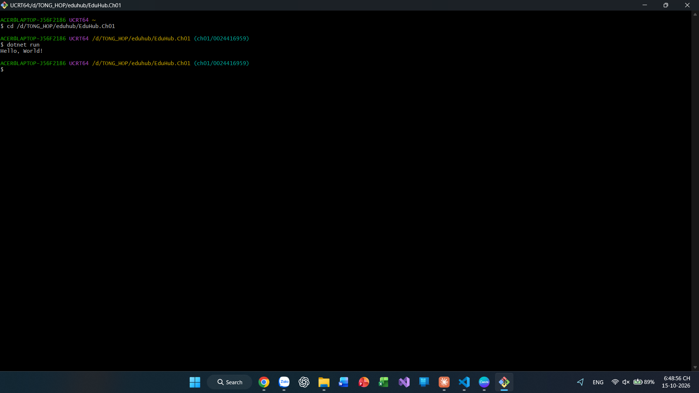

# EduHub.Ch01 – Domain Modeling

Bài tập CH01, môn IN4211 – Phát triển phần mềm hướng đối tượng.

## Thiết kế domain

EduHub quản lý Câu lạc bộ và Sự kiện sinh viên gồm 5 class trong thư mục `Domain/`:

| Class | Vai trò |
|---|---|
| `Member` | Thành viên sinh viên (tên, email, MSSV, ngày tham gia) |
| `Club` | Câu lạc bộ, chứa danh sách `Member` (chỉ đọc bên ngoài), có `AddMember`, `MemberCount` |
| `Event` | Sự kiện của một CLB (`ClubId` là FK), có sức chứa và `HasCapacity` |
| `Registration` | Phiếu đăng ký, bảng nối Member ↔ Event, có trạng thái `Pending/Confirmed/Cancelled` |
| `CheckIn` | Bản ghi điểm danh của một `Registration` (0..1) |

Nguyên tắc áp dụng:
- Property chỉ có `private set`, constructor `private`, tạo đối tượng qua `static Create(...)` có kiểm tra dữ liệu.
- Trạng thái và hình thức check-in là `enum`, không dùng chuỗi rải rác.
- Luật nghiệp vụ nằm trong class: `Confirm()` chỉ từ `Pending`, `Cancel()` không huỷ hai lần (ném `InvalidOperationException`).
- Bật Nullable, XML doc cho mọi public member.

Sơ đồ lớp: xem [docs/class-diagram.md](docs/class-diagram.md). User stories: xem [docs/user-stories.md](docs/user-stories.md).

## Cách chạy

Từ thư mục gốc của repo:

```bash
dotnet run --project EduHub.Ch01
```

Hoặc nếu đang đứng trong thư mục `EduHub.Ch01`:

```bash
dotnet run
```

Yêu cầu .NET 10 SDK.

## Kết quả chạy


