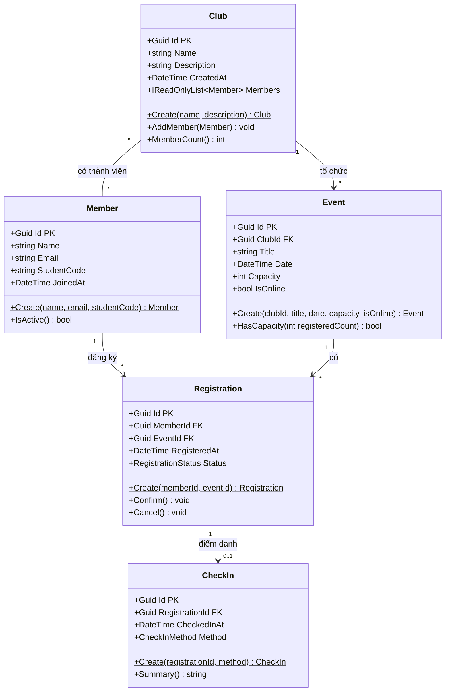

# Class Diagram – EduHub (sơ bộ)

## Giải thích quan hệ

| Quan hệ | Bội số | Ghi chú |
|---|---|---|
| Club – Event | 1 – * | Event giữ khoá ngoại `ClubId` |
| Club – Member | * – * | Một sinh viên tham gia nhiều CLB, một CLB có nhiều thành viên |
| Member – Registration | 1 – * | Registration giữ khoá ngoại `MemberId` |
| Event – Registration | 1 – * | Registration giữ khoá ngoại `EventId` |
| Registration – CheckIn | 1 – 0..1 | CheckIn giữ khoá ngoại `RegistrationId` |

`Registration` là bảng nối biến quan hệ nhiều–nhiều **Member ↔ Event** thành hai quan hệ 1–*.

Enum đi kèm:
- `RegistrationStatus`: `Pending`, `Confirmed`, `Cancelled`
- `CheckInMethod`: `Manual`, `QrCode`, `Nfc`
